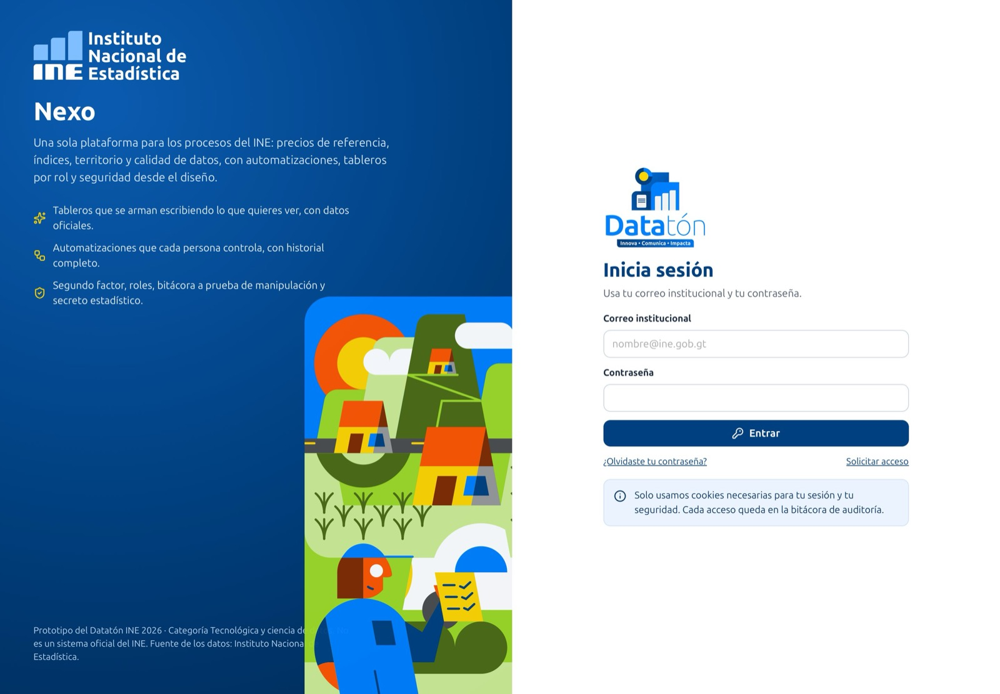
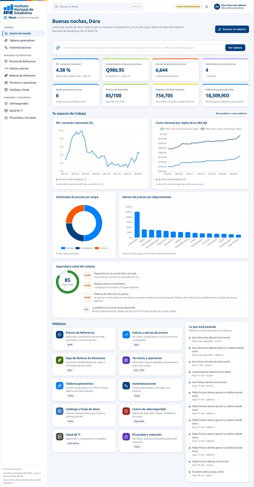
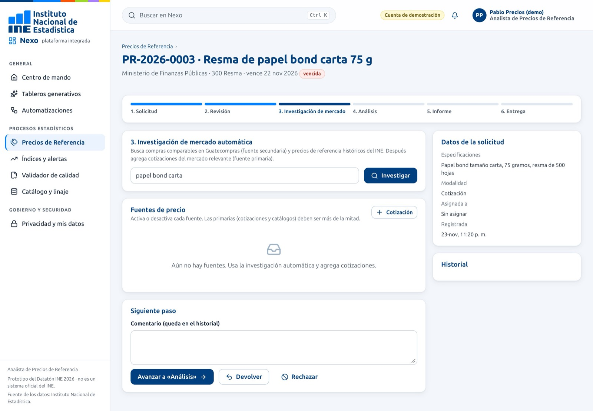
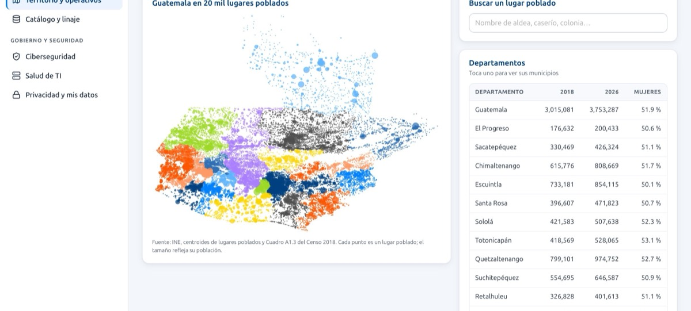
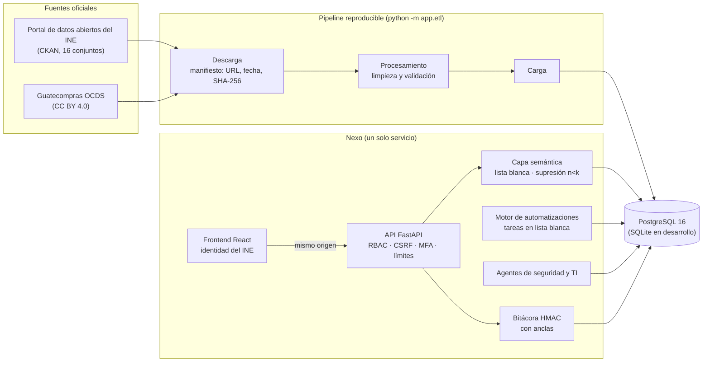

# Nexo · Plataforma integrada de automatización estadística

[](https://github.com/Astral910/nexo-ine/actions/workflows/ci.yml)

> Prototipo para el **Datatón INE 2026, Categoría 2: Tecnológica y ciencias de datos**.
> No es un sistema oficial del Instituto Nacional de Estadística (INE) de Guatemala.
> **Fuente de los datos: Instituto Nacional de Estadística (INE), Guatemala.** Complemento: Guatecompras (OCDS, CC BY 4.0).

Nexo reúne en una sola plataforma los procesos que las Direcciones del INE presentaron el 23 de noviembre de 2026:
- precios de referencia;
- índices y crítica de precios;
- Hoja de Balance de Alimentos;
- territorio y operativos de campo;
- validación de bases de datos.

Cada persona entra con su rol y ve un tablero hecho para su trabajo. Las tareas repetitivas se automatizan, y cada cifra muestra su fuente oficial, su periodo y su fecha de descarga. Toda la plataforma está construida con seguridad y secreto estadístico desde el diseño.

| Acceso con la identidad del INE | Centro de mando |
|---|---|
|  |  |

| Precios de Referencia: los 6 pasos de la DPIR | Guatemala dibujada con 20,036 lugares poblados del Censo 2018 |
|---|---|
|  |  |

---

## 1. Problema que resuelve y usuarios a quienes está dirigida

En el arranque del Datatón, las Direcciones del INE describieron procesos manuales o dispersos:

| Dirección | Necesidad expresada el 23-nov-2026 | Qué hace Nexo |
|---|---|---|
| Precios e Índices de Referencia (DPIR) | Proceso de 6 pasos (solicitud, revisión, investigación de mercado, análisis, informe, entrega) hecho a mano; media, mediana y moda; más del 50 % de fuentes del mercado relevante | Flujo digital completo. Investigación automática en 214 mil compras públicas y en los precios de referencia históricos del INE, ajuste con el IPC, elección del estadístico con el criterio de la DPIR e informe técnico en PDF trazable |
| Índices y Estadísticas Continuas (DIEC) | Alertas de variaciones atípicas de precios (IPP/IPC); catálogo digital del Manual de Características; calculadora de la Hoja de Balance de Alimentos (HBA); validación de bases con herramientas libres (DESA) | Alertas con el método Hidiroglou-Berthelot, catálogo de artículos del IPC, calculadora HBA, tableros de IPC, IPMC y canasta básica, y un validador de calidad |
| Censos y Encuestas (DCE) y Coordinación Regional (DCR) | Herramienta por municipio y lugar poblado; avance de recolección de las delegaciones; reglas de cuidado de datos (factor de expansión, pocos casos, códigos 98/99…) | Fichas municipales con el Censo 2018 y las proyecciones, mapa de 20 mil lugares poblados, seguimiento del avance por delegación, y validador que aplica las 6 reglas de la DCE |

**Usuarios:** personal técnico de las Direcciones, Dirección y Gerencia, Informática, el oficial de seguridad, las entidades públicas que solicitan precios de referencia y el jurado. Un usuario puede tener varios roles y cambiar de espacio de trabajo con un clic.

## 2. Qué incluye

| Módulo | Para quién | Lo principal |
|---|---|---|
| **Centro de mando** | Todos los roles internos | Resumen de toda la plataforma, indicadores clave, espacio de trabajo por rol y actividad reciente |
| **Tableros generativos** | Todos | Escribes «IPC de Quetzaltenango» o «precio de cemento gris por mes en 2025» y Nexo arma el tablero. Muestra cómo entendió la petición, explica sus límites y nunca inventa cifras |
| **Precios de Referencia** | DPIR y entidades | Los 6 pasos de la DPIR, explorador de mercado, regla del 50 % de fuentes primarias e informe PDF con huella SHA-256 |
| **Índices y alertas** | DIEC | Hidiroglou-Berthelot sobre precios recolectados, revisión con bitácora, IPC por región y división, IPMC y canasta básica |
| **Hoja de Balance de Alimentos** | DIEC | Suministro interno, dependencia de importaciones, disponibilidad per cápita y calculadora de derivados |
| **Territorio y operativos** | DCE y DCR | Mapa, fichas municipales, proyecciones 2015–2030 y avance de campo por delegación |
| **Validador de calidad** | DESA y DCE | Datos personales (CUI, NIT, teléfono, correo), códigos 98/99, pocos casos, extremos y reporte para la fuente. El archivo no se guarda |
| **Automatizaciones** | Todos | Programadas o manuales, con historial: vigilar precios, recordar vencimientos, recalcular alertas, sincronizar el catálogo del INE, respaldos y agentes |
| **Catálogo y linaje** | Todos | Cada archivo con URL, fecha de descarga, licencia y SHA-256; catálogo del portal del INE sincronizado por API |
| **Ciberseguridad** | Oficial de seguridad | Agente automático de postura, hallazgos, registro de riesgos 5×5, incidentes y 22 controles con su evidencia en el código |
| **Salud de TI** | Informática | Agente de TI, métricas, respaldos e inventario de componentes con licencias |
| **Bitácora** | Seguridad y jurado | Cadena HMAC-SHA256 con anclas externas: detecta alteraciones, recálculos y borrados |
| **Privacidad** | Todos | Aviso, registro de tratamientos, políticas de retención, «Mis datos» (ver, exportar y pedir eliminación) |
| **Usuarios y roles** | Informática | Aprobación de cuentas, 11 roles, segregación de funciones, desbloqueo y restablecimiento de MFA |
| **Modo Jurado** | Jurado | La rúbrica oficial con evidencia en vivo y un recorrido guiado de 7 minutos |

## 3. Arquitectura general y tecnologías empleadas



| Capa | Tecnología | Por qué |
|---|---|---|
| Backend | Python 3.12, FastAPI, SQLAlchemy 2, Pydantic 2 | Estándar en ciencia de datos y gobierno; documentación OpenAPI automática |
| Base de datos | PostgreSQL 16 (producción y Docker) o SQLite (un solo comando) | Libre, robusta y probada con ambas en CI |
| Frontend | React 19, TypeScript, Vite, Apache ECharts, Lucide | Ecosistema más difundido; gráficas libres que funcionan sin internet |
| Seguridad | Argon2id, TOTP (pyotp), AES-256-GCM (cryptography), HMAC-SHA256 | Algoritmos recomendados por OWASP y NIST |
| PDF | ReportLab | Informes sin dependencias del sistema |
| Despliegue | Docker Compose: una imagen con la aplicación más PostgreSQL | Una sola máquina virtual con software libre |
| Calidad | pytest (SQLite y PostgreSQL), ruff con reglas de seguridad, pip-audit, npm audit, gitleaks en GitHub Actions | Cada commit se verifica |

Más detalle en [docs/ARQUITECTURA.md](docs/ARQUITECTURA.md), [docs/METODOS.md](docs/METODOS.md) y [docs/SEGURIDAD.md](docs/SEGURIDAD.md).

## 4. Instrucciones de instalación y uso

### Requisitos
- **Python 3.11 o superior** (recomendado 3.12). El Python 3.9 que trae macOS no sirve.
- Para Docker: Docker Desktop, o Docker Engine con Compose.
- Node.js 22 solo hace falta para modificar el frontend: el frontend compilado ya viene en `frontend/dist`.
- No necesita internet: los datos oficiales procesados vienen en `data/procesados` con su manifiesto.

### Opción A: un comando, sin Docker (SQLite)

```bash
# macOS o Linux
./iniciar.sh

# Windows (PowerShell)
.\iniciar.ps1
```

El script hace todo esto y luego abre Nexo en **http://localhost:8000**:
- crea el entorno virtual;
- instala las dependencias verificando sus hashes;
- prepara la base;
- carga 754,705 registros oficiales (unos 20 segundos);
- crea las cuentas de demostración.

### Opción B: Docker Compose con PostgreSQL

```bash
cp .env.example .env
python3 -c "import secrets; print('NEXO_BD_CLAVE=' + secrets.token_urlsafe(24))" >> .env
docker compose up --build
docker compose exec app cat /app/var/credenciales-demo.txt   # cuentas de demostración
```

### Opción C: paso a paso

```bash
cd backend
python3.12 -m venv .venv && source .venv/bin/activate        # Windows: .venv\Scripts\activate
pip install --require-hashes -r requirements.txt
python -m app.cli init      # tablas, roles, políticas, automatizaciones y riesgos
python -m app.cli datos     # carga los datos procesados y calcula alertas
python -m app.cli demo      # cuentas de demostración (contraseñas aleatorias)
uvicorn app.main:app --port 8000
```

### Cuentas de demostración
- `python -m app.cli demo` crea una cuenta por rol, con **contraseñas aleatorias** que se guardan en `var/credenciales-demo.txt` (permisos 600, nunca se versiona). El código no contiene ninguna credencial.
- Las cuentas de **administración** y **seguridad** piden configurar el segundo factor (TOTP) al entrar, así que ten a mano una app de autenticación (Google o Microsoft Authenticator, FreeOTP).
- Para la evaluación, la cuenta **jurado** recorre toda la plataforma en solo lectura y abre el Modo Jurado.

### Recorrido sugerido
1. **Jurado → Modo Jurado:** la rúbrica con evidencia y el recorrido de 7 minutos.
2. **Analista DPIR → Precios de Referencia → PR-…-0003:** pulsa «Investigar», agrega cotizaciones, avanza a Análisis e Informe y abre el PDF.
3. **Tableros → «IPC de Quetzaltenango»:** muestra la Región VI y explica que el IPC no se publica por departamento.
4. **Analista DIEC → Índices → Alertas → 2022-07:** revisa una alerta; tu decisión queda en la bitácora.
5. **Registro:** solicita una cuenta. En modo demostración el correo de verificación se ve en pantalla; luego la aprueba un administrador.

### Datos: actualizar desde las fuentes
```bash
cd backend
python -m app.etl todo            # descarga, verifica, procesa y carga (Guatecompras pesa 366 MB)
python -m app.etl descargar --sin-pesadas
python ../scripts/generar_docs.py # regenera docs/DATOS.md y docs/TERCEROS.md
```

### Pruebas
```bash
cd backend && pip install pytest && python -m pytest -q
NEXO_PRUEBAS_BD=postgresql+psycopg://usuario@localhost:5432/nexo_pruebas python -m pytest -q   # contra PostgreSQL
```

## 5. Conjuntos de datos utilizados

**Fuente principal: portal de datos abiertos del Instituto Nacional de Estadística, https://datos.ine.gob.gt.** La lista completa, con la fecha y hora de descarga (23-nov-2026, hora de Guatemala), la licencia declarada en el portal y la huella SHA-256 de cada archivo, está en **[docs/DATOS.md](docs/DATOS.md)**.

| Conjunto (INE salvo indicación) | Se usa en | Registros |
|---|---|---|
| Precios de Referencia (junio 2022 y septiembre 2023) | Precios de Referencia | 5,051 (sin duplicados) |
| Precios recolectados del IPC (julio 2022 y año 2023) | Alertas de precios y catálogo de artículos | 501,022 |
| IPC base 2024=100: empalmes por República, región y división; nombres de divisiones | Índices y ajuste de precios | 8,407 series (con IPMC y CBA) |
| IPMC 2025 y enero a septiembre 2026 | Índices | incluido arriba |
| Costo per cápita de la CBA urbana y rural 2024–2026 | Índices y centro de mando | incluido arriba |
| Hoja de Balance de Alimentos 2024 y Cuentas de Utilización y Suministro | Calculadora HBA | 83 productos y 104 relaciones |
| Censo 2018: centroides de lugares poblados y Cuadro A1.3 | Territorio | 20,036 lugares poblados |
| Estimaciones y proyecciones de población 2015–2030 por municipio | Territorio, HBA y centro de mando | 5,440 |
| **Complemento:** Guatecompras OCDS 2025, publicado por Open Contracting Partnership (CC BY 4.0) | Investigación de mercado | 214,562 compras de un artículo |

**Decisiones de tratamiento** (detalle en [docs/METODOS.md](docs/METODOS.md)):
- **Proyecciones:** en el archivo, los municipios 02 a 17 del departamento de Guatemala vienen con los códigos 23 a 38. Se recodifican y se verificó contra el Censo 2018.
- **Guatecompras:** no se cargan proveedores ni contactos.
- **Precios recolectados:** los informantes solo aparecen como código y nunca fuera del rol de la DIEC.

## 6. Seguridad, privacidad y secreto estadístico

- **Acceso:**
  - Registro con verificación de correo y aprobación de Informática.
  - Contraseñas de al menos 15 caracteres (NIST SP 800-63B-4) guardadas con Argon2id.
  - MFA TOTP obligatorio en roles privilegiados, con códigos de recuperación de 80 bits.
  - Bloqueo por cuenta e IP sin revelar si la cuenta existe.
- **Sesiones:**
  - Guardadas en el servidor, que solo almacena el hash del token.
  - Cookies HttpOnly y SameSite=Strict, más Secure y `__Host-` en producción.
  - CSRF de doble envío.
  - Expiración por inactividad y cierre remoto.
- **Autorización:** 11 roles con mínimo privilegio y segregación de funciones. Quien administra no audita, y quien pide un precio no lo calcula.
- **Datos:**
  - Capa semántica con lista blanca, sin SQL del usuario.
  - Supresión automática de celdas con pocos informantes.
  - Validador que detecta datos personales y no guarda archivos.
  - Políticas de retención con purga diaria.
- **Auditoría:**
  - Bitácora con HMAC-SHA256 y anclas fuera de la base.
  - Agente de ciberseguridad cada 30 minutos.
  - Registro de riesgos e incidentes.
- **Marco:**
  - Decreto-Ley 3-85, art. 25 (confidencialidad estadística).
  - Decreto 57-2008, LAIP (datos personales e información confidencial).
  - Decreto 26-2026, Ley Marco de Ciberseguridad.
  - ISO/IEC 27001:2022, NIST CSF 2.0, OWASP ASVS y Top 10, y principio 6 de la ONU.

El detalle está en [docs/SEGURIDAD.md](docs/SEGURIDAD.md).

## 7. Limitaciones y posibles mejoras

**Limitaciones conocidas**
- **Es un prototipo.**
  - No pasó una prueba de penetración externa.
  - El límite de solicitudes y el programador de automatizaciones viven en el proceso: para varias instancias hacen falta un almacén compartido y un solo programador.
- **Datos públicos disponibles.** Los precios recolectados publicados llegan a 2023:
  - Julio 2022 trae código de informante y permite Hidiroglou-Berthelot.
  - El archivo 2023 no lo trae, así que se usa un detector de desvío de nivel y la supresión exige 5 boletas.
- **Guatecompras.**
  - Solo se usan compras de un artículo con una adjudicación.
  - La unidad de medida no se normaliza entre presentaciones, el IVA no se separa, y el departamento es la sede del comprador (79 % en Guatemala).
  - El ajuste por IPC es una aproximación documentada.
- **Hoja de Balance de Alimentos.** Las relaciones primario → derivado son aparentes (producción del derivado ÷ procesado del primario), no coeficientes técnicos.
- **Generador de tableros.** Es determinista y con vocabulario controlado. Si no entiende, lo dice, pero no cubre todas las formas de preguntar.
- **Datos de demostración.**
  - El avance de operativos y las solicitudes de ejemplo son de demostración y están marcados.
  - El universo del avance (lugares poblados) es real.
- **Pendiente.**
  - Inicio de sesión institucional (Microsoft 365 / Entra ID por OIDC).
  - Migraciones con Alembic.
  - Montos con tipo decimal.
  - Envío de las anclas de la bitácora a un almacenamiento WORM externo.
  - Auditoría completa de accesibilidad.

**Mejoras propuestas**
1. Conectar el registro de informantes y precios del IPP y una app móvil sin conexión para el Manual de Características (propuestas de la DIEC).
2. Descubrir automáticamente los recursos nuevos del CKAN y cargarlos al publicarse cada mes.
3. Validar con la DPIR los parámetros de atípicos y agregar normalización de unidades y presentaciones.
4. Integrarse con el sistema de captura de la Coordinación Regional para el avance real por delegación.
5. Un modelo de lenguaje local (sin enviar datos fuera del INE) para ampliar el generador de tableros.

## 8. Uso de inteligencia artificial

Los lineamientos permiten herramientas de IA generativa si se declaran. Esta es nuestra declaración:
- **Herramienta:** Claude Code (Anthropic), modelo Claude Opus 5.5, usado como asistente de programación durante el evento (del 23 al 26 de noviembre de 2026).
- **Qué hizo:**
  - generó la mayor parte del código, las pruebas y la documentación, siguiendo las indicaciones y decisiones del equipo;
  - investigó las fuentes de datos;
  - extrajo la identidad visual de las presentaciones oficiales.
- **Revisiones:** dos agentes de IA independientes revisaron el proyecto de forma crítica: uno de cumplimiento de lineamientos y calidad, y otro de ciberseguridad y marco legal. Sus hallazgos se corrigieron en commits separados y con pruebas de regresión: buzón de demostración, MFA y zona horaria, bitácora, sesgo de Hidiroglou-Berthelot y agregaciones que inducían a error.
- **Responsabilidad:** el equipo decide el alcance y es responsable del código. Antes de la entrega lo revisa módulo por módulo para poder explicarlo y defenderlo (responsables en [docs/ARQUITECTURA.md](docs/ARQUITECTURA.md)).
- **Commits:** no incluyen a la IA como coautora por decisión del equipo; esta sección es la declaración formal.
- **Dentro de la plataforma:** no se usan modelos de lenguaje ni servicios externos de IA. El generador de tableros y los agentes son reglas deterministas y auditables.

## 9. Servicios de pago o en la nube

**Ninguno.** Todo el software es libre y Nexo funciona en un servidor propio, sin conexión a internet. Las únicas conexiones externas son opcionales:
- la descarga de datos desde el portal del INE y desde data.open-contracting.org;
- un servidor SMTP institucional, si se configura.

## 10. Componentes de terceros

Las librerías conservan sus licencias originales. La lista con versión y licencia está en [docs/TERCEROS.md](docs/TERCEROS.md), y también se consulta dentro de la plataforma en *Salud de TI*. Incluye el logotipo y las ilustraciones del INE tomados de las presentaciones oficiales del Datatón.

## 11. Propiedad intelectual

Según los términos de la Categoría 2, los integrantes conservan el reconocimiento de la autoría y otorgan al Instituto Nacional de Estadística una licencia no exclusiva, gratuita, perpetua e irrevocable para usar, reproducir, modificar, adaptar y distribuir la herramienta y su documentación con fines institucionales.

## 12. Cumplimiento y evaluación

- Matriz de lineamientos y rúbrica: [docs/CUMPLIMIENTO.md](docs/CUMPLIMIENTO.md).
- Guion de la demostración: [docs/GUION-DEMO.md](docs/GUION-DEMO.md).
- El historial de commits es la evidencia del trabajo, desde el 23-nov-2026 a las 22:09 (día 1).

---
Fuente de los datos: Instituto Nacional de Estadística (INE), Guatemala · Guatecompras (OCDS, CC BY 4.0) · Prototipo del Datatón INE 2026.
