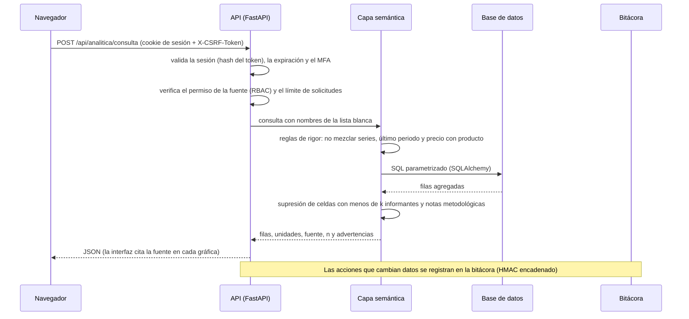

# Arquitectura de Nexo

## Vista general

Nexo es **un solo servicio**: la API FastAPI sirve también el frontend compilado. Esto da tres ventajas:
- un solo origen, sin CORS;
- cookies `SameSite=Strict`;
- una sola imagen de Docker.

La base de datos es PostgreSQL 16 en producción y SQLite en desarrollo; el código es el mismo y ambas se prueban en CI.

```
nexo-ine/
├── backend/app/
│   ├── main.py             arranque, middleware, routers y frontend
│   ├── config.py           configuración por variables NEXO_* (sin secretos en el código)
│   ├── models.py           modelo de datos (≈30 tablas)
│   ├── security/           contraseñas, cifrado, sesiones, límites, cabeceras
│   ├── deps.py             usuario actual, permisos (RBAC) y CSRF
│   ├── bitacora.py         bitácora HMAC con anclas
│   ├── routers/            un archivo por módulo de la API
│   ├── services/           lógica: capa semántica, generador, alertas, precios, validador, agentes, programador
│   ├── etl/                fuentes, descarga con manifiesto, procesamiento y carga
│   ├── siembra.py          catálogos idempotentes (roles, permisos, políticas, riesgos, tableros)
│   └── cli.py              consola: init, admin, demo, datos, verificar
├── backend/tests/          pruebas (acceso, bitácora, rigor estadístico)
├── frontend/src/           React + TypeScript: componentes, páginas, estilos con la identidad del INE
├── data/manifiesto.json    URL, fecha de descarga, licencia y SHA-256 de cada fuente
├── data/procesados/        tablas limpias listas para cargar (sin internet)
└── docs/                   arquitectura, métodos, seguridad, datos, terceros, cumplimiento, guion
```

## Flujo de una petición



## Módulos y responsables

Cada integrante del equipo debe poder explicar los módulos que tiene a cargo. **Completar antes de la entrega.**

| Módulo | Archivos principales | Responsable |
|---|---|---|
| Acceso, sesiones y MFA | `routers/auth.py`, `security/*`, `deps.py` | _(nombre)_ |
| Bitácora y auditoría | `bitacora.py`, `routers/bitacora_api.py` | _(nombre)_ |
| Precios de Referencia | `routers/precios.py`, `services/precios_ref.py`, `paginas/Precios.tsx`, `Solicitud.tsx` | _(nombre)_ |
| Índices, alertas y HBA | `routers/indices.py`, `services/alertas.py`, `routers/hba.py` | _(nombre)_ |
| Capa semántica y tableros | `services/semantica.py`, `services/generador.py`, `routers/tableros.py`, `componentes/Widget.tsx` | _(nombre)_ |
| Territorio | `routers/territorio.py`, `componentes/MapaGT.tsx` | _(nombre)_ |
| Datos (ETL) | `etl/*` | _(nombre)_ |
| Automatizaciones y agentes | `services/programador.py`, `tareas.py`, `agente_*.py` | _(nombre)_ |
| Frontend e identidad visual | `frontend/src/estilos`, `componentes/*` | _(nombre)_ |

## Decisiones de diseño

- **Capa semántica en lugar de SQL libre.**
  - Todas las gráficas piden datos por nombre (fuente, medida, dimensión, filtros) a una lista blanca.
  - Eso impide la inyección.
  - Concentra el secreto estadístico en un solo lugar.
  - Permite aplicar reglas de rigor, por ejemplo no sumar poblaciones entre años.
- **Generador determinista.** Interpreta el español con vocabulario controlado y muestra su interpretación. Sin modelo de lenguaje no hay alucinaciones, costos ni salida de datos.
- **Agentes con reglas.**
  - Los agentes de seguridad y TI son chequeos verificables que abren y cierran hallazgos.
  - Se ejecutan como automatizaciones del sistema y quedan en el historial.
- **Datos reproducibles.**
  - El pipeline descarga, verifica la firma del archivo y registra la huella.
  - Las tablas procesadas viajan con el repositorio para que el jurado no dependa de internet.
- **Un solo proceso programador.**
  - Las automatizaciones corren en un hilo del proceso web, lo que basta para una instancia.
  - Con varias réplicas, el programador debe quedar en un solo proceso: `NEXO_PROGRAMADOR_ACTIVO=false` en las demás.
  - El límite de solicitudes debe pasar a un almacén compartido o al proxy.

## Despliegue recomendado en el INE

1. Una máquina virtual Linux con Docker, detrás del proxy inverso institucional con HTTPS.
2. Variables:
   - `NEXO_ENTORNO=produccion`
   - `NEXO_CLAVE_SECRETA` (48 caracteres aleatorios, en un gestor de secretos)
   - `NEXO_BASE_DATOS_URL` (PostgreSQL)
   - `NEXO_URL_PUBLICA`
   - `NEXO_DOMINIOS_CORREO_PERMITIDOS=ine.gob.gt`
   - SMTP institucional
3. `uvicorn --proxy-headers --forwarded-allow-ips=<IP del proxy>` para registrar la IP real.
4. Respaldos diarios de PostgreSQL con `pg_dump` fuera del servidor, más prueba de restauración trimestral.
5. Copiar `var/anclas-bitacora.log` a un almacenamiento de solo anexado (syslog o WORM).
6. Crear la primera cuenta de administración con `python -m app.cli admin` y desactivar las cuentas de demostración.
